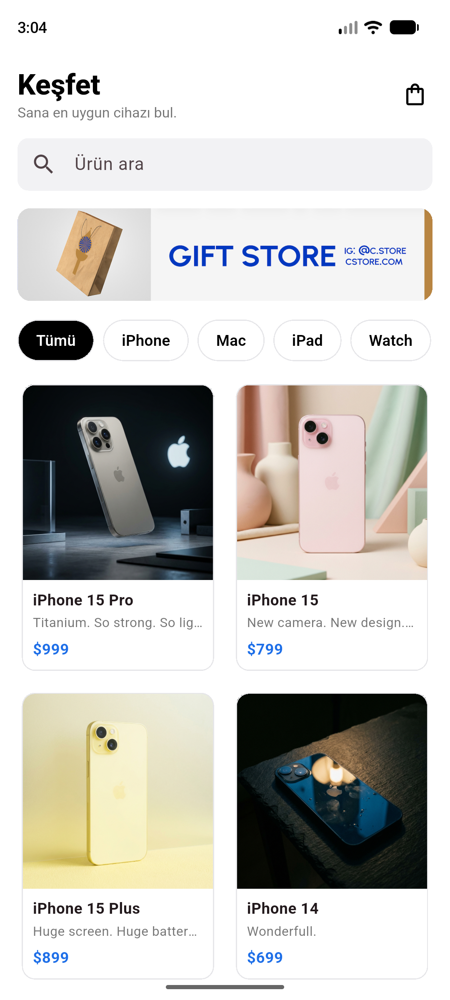
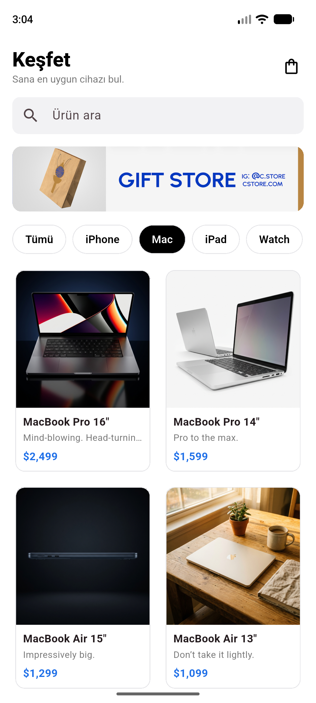
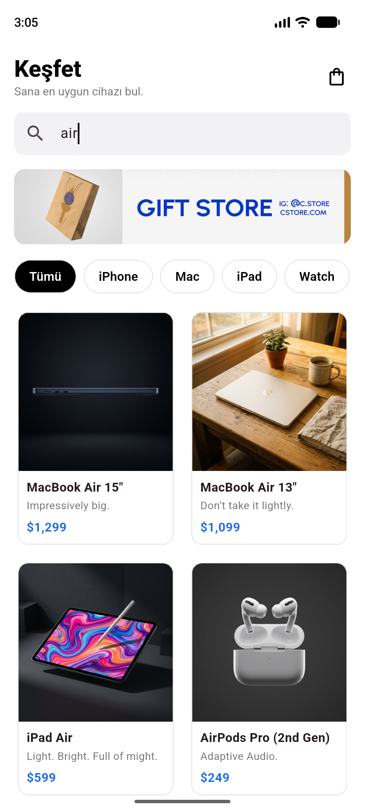
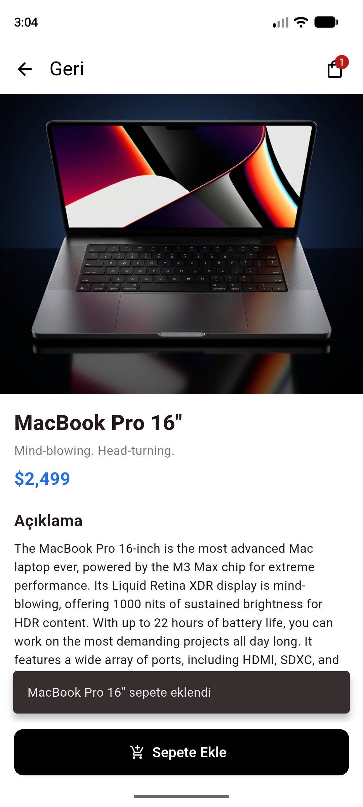
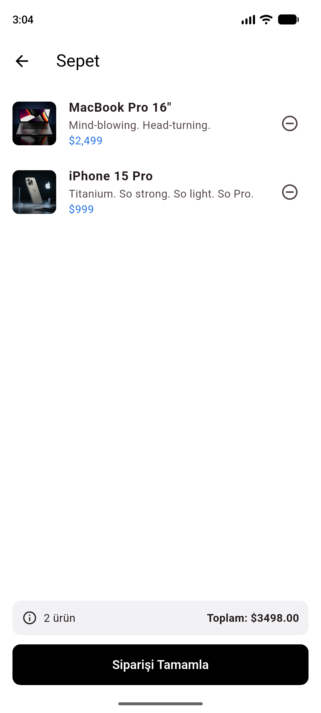
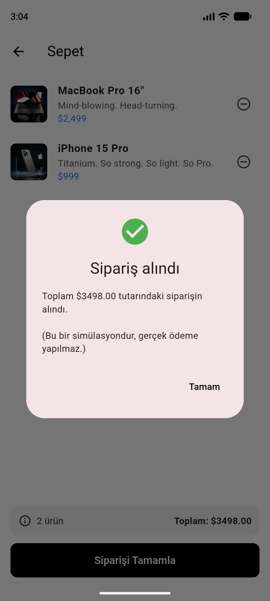
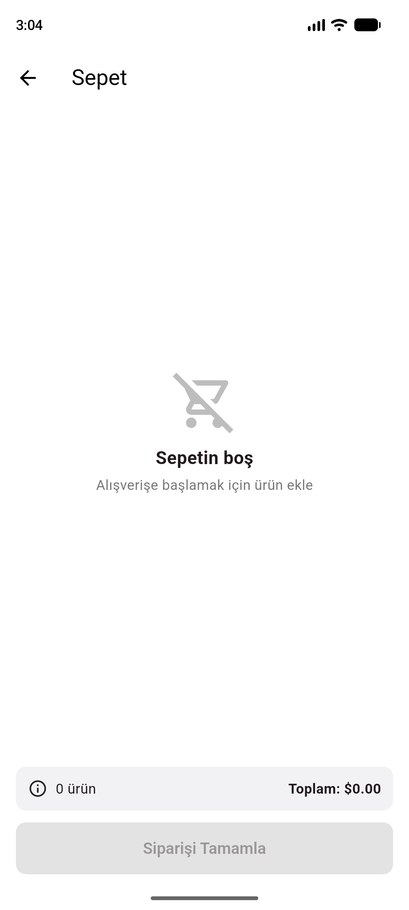

# Mini Katalog Uygulaması

Flutter ile geliştirilmiş, ürünlerin listelendiği, detaylarının görüntülendiği ve sepete eklenebildiği basit bir mobil katalog uygulaması. Flutter Günlük Eğitim kapsamında hazırlanmıştır.

Uygulama yalnızca Flutter'ın kendi kütüphaneleriyle (`material.dart`) yazılmıştır, ekstra paket kullanılmamıştır. Ürün verileri [wantapi.com/products.php](https://wantapi.com/products.php) adresinden alınıp `assets/data/products.json` dosyasına kaydedilmiştir. Uygulama bu dosyayı okuyarak API çağrısını simüle eder.

## Özellikler

- **Ana sayfa:** arama kutusu, banner, kategori filtresi (Tümü / iPhone / Mac / iPad / Watch / Ses) ve `GridView` ile ürün kartları
- **Ürün detayı:** görsel, açıklama, özellikler (specs) ve "Sepete Ekle" butonu
- **Sepet:** eklenen ürünlerin listesi, ürün silme, toplam tutar, boş sepet ekranı ve sipariş onayı (simülasyon)
- Named Routes ve Route Arguments ile sayfa geçişleri
- `Product` model sınıfı (`fromJson` / `toJson`)
- `setState` ve `ChangeNotifier` ile basit state yönetimi
- Hero animasyonu ile görsel geçişi

## Kullanılan Sürümler

| Araç | Sürüm |
|---|---|
| Flutter | 3.47.7 (stable) |
| Dart | 3.13.5 |

## Çalıştırma Adımları

1. Flutter SDK'nın kurulu olduğundan emin olun:
   ```bash
   flutter doctor
   ```
2. Projeyi klonlayın:
   ```bash
   git clone https://github.com/KamileGULER/urun.git
   cd urun
   ```
3. Bağımlılıkları yükleyin:
   ```bash
   flutter pub get
   ```
4. Bir Android emülatörü başlatın veya fiziksel cihaz bağlayın, ardından uygulamayı çalıştırın:
   ```bash
   flutter run
   ```
5. (İsteğe bağlı) Testleri çalıştırın:
   ```bash
   flutter test
   ```

## Proje Yapısı

```
lib/
├── main.dart                       # Uygulama girişi, tema ve route tanımları
├── models/
│   └── product.dart                # Ürün model sınıfı (fromJson / toJson)
├── data/
│   ├── product_repository.dart     # JSON verisini assets'ten okur (API simülasyonu)
│   └── cart.dart                   # Sepet state'i (ChangeNotifier)
├── screens/
│   ├── home_screen.dart            # Ana sayfa: arama, filtre, GridView
│   ├── product_detail_screen.dart  # Ürün detay sayfası
│   └── cart_screen.dart            # Sepet sayfası
├── widgets/
│   ├── product_card.dart           # Ürün kartı
│   └── cart_button.dart            # Rozetli sepet ikonu
└── theme/
    └── app_theme.dart              # Uygulama teması
assets/
├── data/products.json              # Ürün verileri
└── images/                         # Ürün görselleri ve banner
```

## Ekran Görüntüleri

| Ana Sayfa | Kategori Filtresi | Arama | Ürün Detayı |
|---|---|---|---|
|  |  |  |  |

| Sepete Eklendi | Sepet | Sipariş Onayı | Boş Sepet |
|---|---|---|---|
|  |  |  |  |

## Not

Kullanılan veri kaynakları ([wantapi.com](https://wantapi.com)) yalnızca eğitim ve demo amaçlıdır, gerçek bir e-ticaret altyapısını temsil etmez. Ürün adları ve markalar ilgili sahiplerine aittir.
